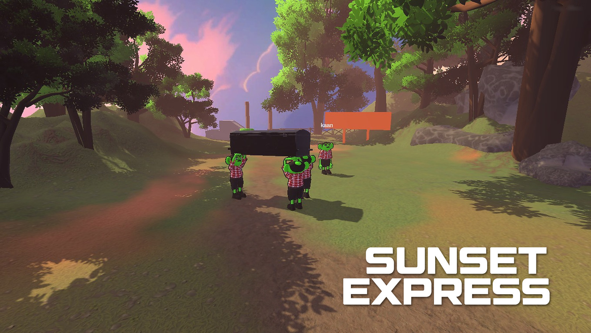

# Sunset Express

> A co-op physics game about carrying a coffin, with a corpse sliding around inside it, to a grave across a hostile level.

**Genre:** co-op physics comedy · **Players:** 2, designed to scale to 4 · **Platform:** PC (Steam)
**Tech:** Unity 6 (URP), C#, Fish-Networking, Steamworks.NET · **Team:** 3, ~6 weeks, mid-2026 · **Status:** discontinued Aug 2026

## Pitch

Your crew runs a funeral service that takes the jobs nobody else will: pick a darkly comic contract from the hub's board, lift the coffin and carry it over seesaw bridges, moving platforms and drops. The body inside isn't fixed: tilt the coffin and the corpse slides, dragging the centre of mass with it. Tilt too far and the lid pops open. Lose the body and the funeral report says so. The comedy comes from physics, never from random events.

## Design pillars

From the team's [GDD v0.3](https://kaaneskikalci.com/files/sunset-express-gdd-en.pdf) (July 2026), section 1.4:

1. **Fair jank.** Every fall should be funny but feel like your own fault: physics about 90% predictable, 10% chaotic.
2. **The coffin is the fifth player.** Its centre of mass shifts, the corpse moves inside and the lid opens. As just a heavy box, it would be any other co-op carrying game.
3. **Coordination comedy.** Every obstacle is easy alone and a nightmare together.
4. **Modular contracts.** A catalogue of self-contained jobs replaces a linear story, and every corpse is a mechanical variation.
5. **Small scope, high polish.** A few excellent contracts beat many mediocre ones, so the Early Access set was fixed at four.

The code turns these into hard rules, and its comments cite the GDD sections:

- **Readable triggers (1.4).** Every failure has a cause players can learn, such as a tilt angle, an impact or a sustained condition. Nothing is random.
- **Difficulty from physics, not multipliers (4.5).** Each character's movement force is fixed, so the coffin's mass is what slows the team, and extra carriers genuinely make it lighter.
- **Release always works (6.5).** Letting go is a panic button that fires instantly, whatever else is happening.
- **Watch the coffin, not the HUD (13.2).** There is no strain bar, only a shaking hand icon when a grip is close to breaking.
- **No soft-locks (4.6).** Damage can destroy the lid but never the coffin body.

## Core loop

1. **Hub:** read the contract board (brief, difficulty 1–5). The host starts the contract.
2. **Carry:** get the coffin through the level. Players who die respawn next to it.
3. **Bury:** the contract completes only when nobody is holding the coffin and it has settled in the grave, so the team has to let go together.
4. **Report:** time, coffin damage, and whether the corpse actually arrived.

Payment and end-of-job stats were designed but deliberately left out until the economy was settled ([`ContractReport.cs`](Assets/_Game/Scripts/Runtime/GameLoop/ContractReport.cs)).

## Key mechanics

**1. Carrying and grip.** Players hold the coffin through a spring joint, never through parenting. The host measures joint force and hand drift each physics step and breaks the grip past a threshold. A three-tier warning (~50/65/80%) uses amplitude, scale and colour, so it reads without colour.
*Intent:* make callouts ("slow down, I'm slipping!") matter without a meter.
→ [`PlayerGrabber.cs`](Assets/_Game/Scripts/Runtime/Player/PlayerGrabber.cs), [`GripWarningHud.cs`](Assets/_Game/Scripts/Runtime/UI/GripWarningHud.cs)

**2. Corpse simulation.** In *Mode A* the corpse is one weight that slides head-to-foot and shifts the centre of mass. That creates a deliberate feedback loop: tilt, slide, more tilt. In *Mode B*, if the lid is open and the tilt holds past a threshold, the body falls out as a ragdoll, and that loss is permanent.
*Intent:* panic moments that stay predictable, synced as a single float instead of a full ragdoll.
→ [`CorpseSlide.cs`](Assets/_Game/Scripts/Runtime/Coffin/CorpseSlide.cs)

**3. Lid, damage and corpse variants.** A latch in code releases the lid on tilt or a hard impact and re-locks it once the coffin is righted. Damage lowers the release threshold and loosens the hinge. Corpse variants are data assets that bend the rules: a sealed pharaoh, a basketball player who doesn't fit, a sumo wrestler, a wind-blown elderly lady.
*Intent:* the lid is a crisis the team can recover from, and the real penalty is losing the body. Designers add variants without code.
→ [`CoffinLid.cs`](Assets/_Game/Scripts/Runtime/Coffin/CoffinLid.cs), [`CoffinDamage.cs`](Assets/_Game/Scripts/Runtime/Coffin/CoffinDamage.cs), [`CorpseProfile.cs`](Assets/_Game/Scripts/Runtime/Physics/CorpseProfile.cs)

**4. Synchronised jump.** One carrier only manages a weak hop. When everyone jumps together their momentum combines and the coffin lifts. Joints stiffen briefly after a jump so the impulse reaches the coffin.
*Intent:* a coordination check you shout out loud ("3, 2, 1, jump!").
→ [`PlayerProfile.cs`](Assets/_Game/Scripts/Runtime/Physics/PlayerProfile.cs), [`DebugSyncJump.cs`](Assets/_Game/Scripts/Runtime/Debugging/DebugSyncJump.cs)

**5. Physics-driven obstacles.** The seesaw bridge has no tilt logic. It's a hinged rigidbody, and the weight on it does the work. One panicking player can tip everyone off.
→ [`SeesawBridge.cs`](Assets/_Game/Scripts/Runtime/Obstacles/SeesawBridge.cs), [`MovingPlatform.cs`](Assets/_Game/Scripts/Runtime/Obstacles/MovingPlatform.cs)

**Under the hood:** Unity never steps physics on its own (`m_SimulationMode: 2`, [`DynamicsManager.asset`](ProjectSettings/DynamicsManager.asset)). FishNet's tick loop runs the simulation. Players are client-predicted, and the coffin is host-simulated and replicated. All tuning values live in ScriptableObject profiles.

## My role

I was responsible for game design alongside gameplay and network programming: coffin physics, the grab/release/break systems, corpse simulation, player controls and camera, carrying and jumping, and the network architecture with its prediction and synchronisation. Art, level content and part of the design belonged to the rest of the team.

Ozanay was the second gameplay programmer: the core loop (contracts, delivery, reports), the seesaw bridge and moving platform obstacles, the HUD/UI and the economy. Baran did the 3D art, level greyboxing and shaders. Part of the design came from them too.

AI-assisted development (Claude Code, Codex).

Two design calls in the systems I owned:

- **Mass, not a speed penalty.** Playtesters said the coffin felt too light. The easy fix was a speed penalty while carrying. Instead, movement became force-limited: a force band whose floor derives from mass and preserves the unloaded feel, and whose ceiling sets carrying capacity. Now the coffin's real mass slows the team, and the GDD 4.5 rule stays intact.
- **Tolerate the group jump, don't weaken it.** Two players jumping together at first broke every grip. Rather than reduce jump force, for a 0.4 s window the break threshold doubles and the joint spring stiffens threefold, so the impulse lifts the coffin instead of tearing the grips loose.

## Playtest changes (Aug 2026)

Code comments and the case study record several changes made after playtests:
- Removed mouse-wheel raise/lower. It added no meaningful feel.
- Split the grip warning from a single 70% threshold into three tiers.
- Corpse ejection now needs a *sustained* tilt. Single violent frames were dumping bodies unreadably.
- Weakened the solo carry-jump and stiffened joints so group jumps actually lift the coffin.
- Stopped tuning lid-damage values once it turned out the hinge spring behind that behaviour wasn't active, so the result could never appear.

## Why development stopped

The prototype passed its internal Stage 0 feel test. Even so, the team grew less confident that the interaction had enough depth to sustain a full game. An active-ragdoll pivot also proved incompatible with the deterministic, tick-ordered architecture the game relied on. The [technical postmortem](https://kaaneskikalci.com/files/sunset-express-technical-postmortem.pdf) covers the three failed attempts. Stopping was a production decision: we chose not to keep investing in content and technical fixes before the underlying loop had proven worth scaling.

What I learned:

- **Validate the loop, not just the interaction.** A good thirty seconds is not evidence of a good twenty minutes. We proved the coffin was fun to handle, not that carrying it contract after contract could sustain a game.
- **Check a feature against the constraint holding the game up.** Determinism was load-bearing here, and the ragdoll pivot cut straight through it. A two-day spike in an isolated scene would have answered the risky question before two weeks went into it.
- **Separate tuning problems from architectural ones.** When repeated parameter changes stop improving behaviour, the model is the suspect. Diagnose the system before tuning it.
- **Cut the rollback branch before the pivot.** Ours was created after things had already gone sideways.

Technical difficulty and design quality are different problems. We solved hard engineering challenges and still didn't have a game worth finishing.

## Post-cancellation polish (Nov 2026)

After the project was cancelled, I went back for a short polish round so the build could be recorded for my portfolio. It lives on a separate branch of the private repository; this mirror still shows the August 2026 code. The core loop, physics and network architecture did not change, and no mechanics were added.

- **Both test levels can be finished.** The second test level had no delivery point, so its contract could never end; one was added. The grave trigger rejected a coffin resting at an angle, so delivery never completed; its volume was enlarged.
- **Readable state.** The delivery sign shows each step ("Let go of the coffin (E)", "Hold still…", "Delivering…", "Delivered."). A real grip break flashes "GRIP LOST", a hand icon replaces the placeholder grip warning, and the death screen reads "OFF THE CLOCK" with "Respawning…".
- **Clean presentation.** A corpse model replaces the capsule (same physics), network debug overlays are off, player-facing text is in English, and the contracts were renamed.
- **Small fixes.** Dead players can no longer grab the coffin, larger kill zones stop falling players from getting stuck alive, and movement is locked while the contract board or report is open.

Left alone on purpose: the August tuning values, the lid behaviour, and recovering a coffin that falls off the map. Changing them would alter gameplay or need new network code. There is still no sound.

**Verified:** compiles cleanly in Editor and release builds. In play, only delivery was confirmed working (two players, 7 Nov 2026); the rest has not been checked in play yet.

## Media

**Playtest cut (Aug 2026, 78 s):** https://www.youtube.com/watch?v=mcXKjBXpUOE

**Case study:** https://kaaneskikalci.com/dev/sunset-express/ · **GDD v0.3 (PDF):** https://kaaneskikalci.com/files/sunset-express-gdd-en.pdf · **Technical postmortem (PDF):** https://kaaneskikalci.com/files/sunset-express-technical-postmortem.pdf

## Repository guide

**Code-only mirror:** C# source and project settings. Art, scenes, prefabs and FishNet (an Asset Store product) aren't included, so it won't compile. It's here to be read.

| Path (`Assets/_Game/Scripts/Runtime/…`) | Contents |
|---|---|
| [`Coffin/`](Assets/_Game/Scripts/Runtime/Coffin) | Coffin body, lid latch, damage, corpse simulation |
| [`Player/`](Assets/_Game/Scripts/Runtime/Player) | Predicted controller, grab/carry, arm IK, camera |
| [`Physics/`](Assets/_Game/Scripts/Runtime/Physics) | Tuning profiles (coffin, corpse, player, obstacles) |
| [`GameLoop/`](Assets/_Game/Scripts/Runtime/GameLoop) | Contracts, grave/delivery, respawn, lethal zones |
| [`Obstacles/`](Assets/_Game/Scripts/Runtime/Obstacles) · [`Networking/`](Assets/_Game/Scripts/Runtime/Networking) · [`UI/`](Assets/_Game/Scripts/Runtime/UI) | Obstacles · scene flow and Steam lobby · HUD, menus, report |

**GDD:** not in this repo. The English GDD v0.3 is on my site as a [PDF](https://kaaneskikalci.com/files/sunset-express-gdd-en.pdf), alongside the [case study](https://kaaneskikalci.com/dev/sunset-express/) and the [technical postmortem](https://kaaneskikalci.com/files/sunset-express-technical-postmortem.pdf). Code comments are in Turkish and cite its section numbers (e.g. "GDD 4.5").

*Internal working and repository name: `Coffin`. Licence: [MIT](LICENSE), covering the source in this repository only.*
